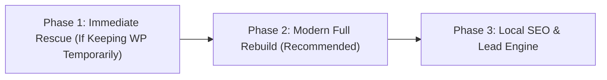

# Comprehensive Website Audit: `avsinc.us` (Audio, Video & Security, Inc.)

> [!CAUTION]
> **Executive Verdict: High-Priority Rebuild / Modernization Opportunity**
> `http://avsinc.us/` has scarcely been touched since January 2014. Because of an incomplete server migration and a decade of link rot, **the homepage is visually and functionally broken for every visitor**—16 homepage images point to a dead staging IP (`72.249.166.137`), the featured company video returns `404 Not Found`, and the site lacks HTTPS (`Not Secure` warning in all modern browsers). Because the site only has **5 core pages**, it is an ideal candidate for a complete, high-converting redesign.

---

## 1. Critical Visual & Functional Breakage (What Visitors Experience Today)

### A. 16 Broken Images on the Homepage (Hardcoded Staging IP)
Every major visual element on the homepage points to an abandoned cPanel temporary URL (`http://72.249.166.137/~avssys/wp-content/uploads/2014/01/...`) that **times out and fails to load**:
- **All 3 Hero Slider Banners:**
  - `http://72.249.166.137/~avssys/wp-content/uploads/2014/01/Control4_Lifestyle_078.jpg`
  - `http://72.249.166.137/~avssys/wp-content/uploads/2014/01/Control4_Lifestyle_075.jpg`
  - `http://72.249.166.137/~avssys/wp-content/uploads/2014/01/Control4_Lifestyle_029.jpg`
- **All 4 Service Category Thumbnails (`Security`, `Cameras`, `Home Automation`, `Lighting`):**
  - `DMP-Alarm-System-hp.jpg`, `dmp-video-surveillance-hp.jpg`, `Mobile_2hp.jpg`, `Control4_Lifestyle_062.jpg`
- **All 9 Brand Partner Logos in the Footer Carousel:**
  - `Control_Gold.jpg` (Control4), `Black-and-Gold-DMP-logo.jpg` (DMP), `Allworx-partner-logo.jpg` (Allworx), `Samsung-Logo.jpg`, `rs21.jpg` (RS2), `marantz_logo.jpg`, `logo1.jpg` (Seatcraft), `logo_medium_definitive.jpg`, `epson.jpg`

> [!IMPORTANT]
> **Why This Also Freezes Page Initialization:**
> The homepage scripts (`NivoSlider`, `Backstretch` for the Residential/Commercial sidebar tiles, and `CarouFredSel` for the brand logos) are initialized inside `$(window).load(function() { ... })`. Because `72.249.166.137` silently drops packets instead of rejecting them immediately, the browser hangs waiting for 16 TCP connections to time out before the homepage layout finishes initializing.
> *(Note: All 16 image files actually exist on the live server under `http://avsinc.us/wp-content/uploads/2014/01/...` and return `HTTP 200 OK`—the URLs were simply never updated when the site launched in 2014.)*

### B. Dead Homepage Video (`404 Not Found`)
Under the **"WHO WE ARE"** column on the homepage, the embedded Vimeo player (`https://player.vimeo.com/video/155398390`) returns **`HTTP 404 Not Found`**, rendering a large Vimeo error screen right in the center of the homepage. It also uses a hardcoded `width="400"`, causing horizontal overflow on smaller viewports.

### C. Placeholder "Lorem Ipsum" URLs & Blank Pages
- **Lorem Ipsum Slugs Linked from the Hero Slider:** Clicking the three hero slider captions takes users to 2014 posts with unedited Latin placeholder slugs and single-sentence body copy:
  - `http://avsinc.us/featured/nam-eget-erat-volutpat-ultrices-nibh-dignissim-auctor-arcu/` (*"Master Control in Every Room"*)
  - `http://avsinc.us/featured/praesent-nec-scelerisque-nunc-ac-pellentesque-sem/` (*"Whole Home Communication"* — 1 sentence of text)
  - `http://avsinc.us/featured/mauris-molestie-felis-erat-dapibus/` (*"Audio/Video"* — 1 sentence of text)
- **Blank `/services/` Page:** `http://avsinc.us/services/` is listed in `page-sitemap.xml` with `0.8` priority, but its content container is completely empty (`<div class="content"></div>`). Meanwhile, the top-level **Services** link in the navbar points to `href="#"`.
- **Dead Outbound Partner Links:**
  - **RS2 Technologies** (`https://rs2tech.com/RS2WebApp/`) → `404 Not Found`
  - **Marantz** (`http://us.marantz.com/us/pages/home.aspx`) → `404 Not Found`
  - **Epson** (`http://www.epson.com/cgi-bin/Store/jsp/index.do`) → `403 Forbidden`

---

## 2. Security & Infrastructure Audit

For a company whose core business is **security**, the site's technical security posture is a major brand liability:

| Component / Check | Current State on `avsinc.us` | Risk & Impact |
| :--- | :--- | :--- |
| **HTTPS / SSL** | **None** (`https://avsinc.us/` fails to connect) | Chrome, Safari, and Edge display a **"Not Secure"** warning in the address bar and flag the `/contact/` and `/2-months-free-monitoring/` forms as insecure. Customer contact details are sent in cleartext. |
| **PHP Version** | **`PHP/5.4.45`** (exposed in `X-Powered-By` header) | Reached End-of-Life in **September 2015** (over 11 years of unpatched CVEs). |
| **WordPress Core** | **`WordPress 4.3.33`** (4.3 released Aug 2015) | Over a decade behind modern WordPress (`6.x`), running legacy plugins (`Gravity Forms 1.9.13`, `Yoast SEO 2.3.4`, `Jetpack 3.6.4`). |
| **Admin Username Exposure** | Exposed via `/author-sitemap.xml` | Publicly advertises login usernames (`wp-admin`, `nexxtep`, `contributor`, `august99`) while `/wp-login.php` and `/readme.html` are publicly accessible. |
| **Form Spam Protection** | None on `/contact/` or `/2-months-free-monitoring/` | No reCAPTCHA, Cloudflare Turnstile, or honeypot protection on either Gravity Form. |
| **HTTP Security Headers** | **0 / 5 present** | Missing `Strict-Transport-Security`, `Content-Security-Policy`, `X-Frame-Options`, `X-Content-Type-Options`, and `Referrer-Policy`. |

---

## 3. Code Quality, Performance & Accessibility Issues

1. **Accessibility Violation in Viewport Meta Tag:**
   ```html
   <meta name="viewport" content="width=device-width, initial-scale=1.0, maximum-scale=1.0, user-scalable=no">
   ```
   Setting `maximum-scale=1.0, user-scalable=no` blocks pinch-to-zoom on mobile devices and fails WCAG 2.1 AA accessibility criteria ( and Google Lighthouse audits).
2. **Uncompressed 1.14 MB Image Used as a 150×150 Thumbnail:**
   On `/residential-services/`, the `Lighting` section loads the full-resolution `Control4_Lifestyle_078.jpg` (**1,143,412 bytes / 1.14 MB**) and shrinks it in HTML via `width="150" height="150"`.
3. **Spacing via `&nbsp;<br />` Hacks Instead of CSS:**
   On `/residential-services/` and `/commercial-services/`, each service item floats a `150x150` image left and then inserts **5 to 8 consecutive `&nbsp;<br />` lines** (plus an empty `<h3></h3>` tag) to manually push the next heading below the thumbnail—causing erratic whitespace on mobile and tablet screens.
4. **Invalid HTML Structure:**
   - **Duplicate `<title>` tags** in `<head>`, producing doubled page titles across the site (e.g., `About - Audio, Video, Security, Inc. - Audio, Video, Security, Inc.`).
   - **Scripts placed after `</body>`:** Seven `<script>` tags and the inline initialization script are placed *outside* the closing `</body>` element.
   - **Nested `<p><p>...</p></p>` tags** inside the slider captions.
   - **Missing `alt` attributes** on the main logo, all 3 slider images, all 4 homepage service cards, and all 9 brand logos, plus non-descriptive alt attributes (`alt="vHVn"`, `alt="Mobile_2"`) on inner pages.

---

## 4. Content, Local SEO & Conversion Optimization (CRO)

### A. Outdated 2014 Messaging & Contract Copy
- **Legacy Tech References:**
  - `/commercial-services/` advertises **"T1 or T1/PRI"** phone lines and **"View up to six cameras 24-7... and get real-time alerts via email."**
  - The footer link **"Download Our Contract"** (`/wp-content/uploads/2014/02/avs-contract.pdf`) downloads a dense 2-page 2014 legal terms sheet that references **RJ31X landline jacks interrupting 911 calls**—which intimidates prospective leads instead of encouraging them to request a consultation.
- **Brand Name Inconsistency:** The site alternates between **"Audio, Video & Security, Inc."**, **"AVS, Inc."**, and **"AVS Systems"** across pages.

### B. Local SEO Gaps (Valdosta & South Georgia)
- **Empty Google Search Console Verification:** `<meta name="google-site-verification" content="">` is unconfigured.
- **No `LocalBusiness` Structured Data:** The site only outputs a generic `WebSite` schema with a WordPress search action (`/?s={search_term_string}`). Adding `LocalBusiness` / `HomeAndConstructionBusiness` JSON-LD with AVS's address (`1619 Baytree Rd., Valdosta, GA 31602`), phone (`(229) 244-0200`), business hours (`M-F 8 AM - 5 PM`), founders (`Mike Sheffield, Cris Sheffield, Steve Boyd`), and service areas (Valdosta, Lowndes County, South Georgia) will directly boost Google Local Pack visibility.

### C. Conversion Blockers
- **Unclickable Phone Numbers:** `(229) 244-0200` on the homepage and contact page is plain text, not a tap-to-call `<a href="tel:+12292440200">` link, and there is no phone number or **"Get a Free Quote"** button in the header/navigation bar.
- **No Social Proof:** Despite being in business in Valdosta since 2008, the site has zero customer reviews, testimonials, local commercial client logos, or project photos (the only real photo is a 2014 van picture on `/about/`).
- **No Map on Contact Page:** `/contact/` lists `1619 Baytree Rd., Valdosta, GA 31602` as plain text with no interactive map or directions link.

---

## 5. Recommended Improvement Roadmap



### Option 1: Full Modern Rebuild (Strongly Recommended)
Because the entire site is only **5 core pages** (`Home`, `About`, `Residential Services`, `Commercial Services`, `Contact` + `Special Offer`), rebuilding it as a clean, fast, modern website gives you a dramatic before-and-after upgrade without fighting 2014 WordPress tech debt:
1. **Modern High-Trust Design:** Dark/sleek security & smart-home aesthetic with instant load times, responsive grid layouts, and zero broken assets.
2. **Conversion-First UX:** Sticky header with tap-to-call `(229) 244-0200`, interactive **"Request a Free Security / AV Quote"** modal or multi-step form, and prominent **"2 Months Free Monitoring"** promo banner.
3. **Updated 2026 Service Lineup:** Highlight modern DMP alarm/cellular monitoring, 4K AI video surveillance, Control4 whole-home automation, smart lighting, commercial access control, fire/cellular FACP upgrades, modern VoIP/network wiring, and conference rooms.
4. **Built-in Local SEO & Accessibility:** Full `LocalBusiness` schema for Valdosta, GA, WCAG AA accessibility compliance, semantic HTML5, and optimized images.

### Option 2: Emergency Patch on Existing WordPress Site
If you only want to patch the live WordPress site first:
1. Replace all 16 `http://72.249.166.137/~avssys/` URLs with `/wp-content/uploads/` so the homepage slider, service cards, and brand carousel work immediately.
2. Remove or replace the dead Vimeo iframe (`155398390`).
3. Provision an SSL certificate (Let's Encrypt) and force HTTPS redirects + fix mixed-content `http://` asset links.
4. Upgrade PHP (`5.4` → `8.2+`), WordPress core, and plugins, and disable author archives (`/author-sitemap.xml`).
